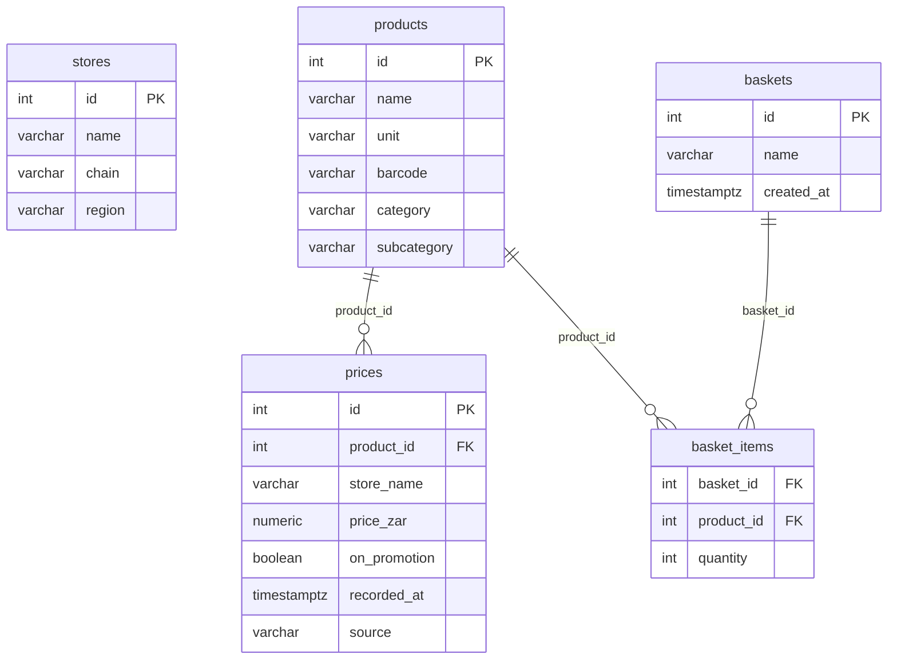

# SA Grocery Price Intelligence Platform

> Track SA grocery prices across supported retailers, surface inflation trends by category, and find the cheapest store combination for your weekly basket.

[](https://python.org)
[](https://fastapi.tiangolo.com)
[](https://supabase.com)
[](https://airflow.apache.org)
[](https://docker.com)

> **CI badge removed for now** — GitHub Actions isn't set up yet (see Roadmap). Will be re-added once `.github/workflows/test.yml` exists.

---

## The Problem

Comparing grocery prices in South Africa is a snapshot game — you can check who is cheapest today, but nobody shows you who has been *consistently* cheaper over time, how fast specific categories are inflating, or how to split a shopping list across stores to minimise total spend.

This project builds the data infrastructure to answer those questions.

---

## Live Demo

| | Link |
|---|---|
| 🌐 Dashboard | Not deployed yet — frontend hasn't been built (see Roadmap) |
| 📡 API (Swagger UI) | Not deployed yet — runs locally via `docker compose up`, see Quick Start |

---

## What It Does — Current Status

| Feature | Status |
|---|---|
| Price trend tracking (`/trends`) — week-over-week change via SQL `LAG()` | ✅ Working |
| Store comparison (`/compare`) — cheapest store first, by category | ✅ Working |
| Inflation analysis (`/inflation`) — month-over-month % change per category | ✅ Working |
| Basket optimizer (`/basket`) — single store vs. cheapest split | ✅ Working |
| Dashboard UI | ⬜ Not started |

---

## System Architecture

```
┌─────────────────────────────────────────────────────────┐
│                     DATA SOURCES                         │
│   Open Price Engine API        BusinessTech CSV          │
│   (Pick n Pay + Woolworths)    (up to 10 canonical       │
│            daily                stores, monthly)         │
└──────────────────┬──────────────────┬───────────────────┘
                   │                  │
                   ▼                  ▼
┌─────────────────────────────────────────────────────────┐
│            ETL PIPELINE  (Apache Airflow)                │
│       Extract → Normalize → Validate → Load              │
│                                                          │
│  • Retries: 2 attempts, 60s backoff on HTTP 429           │
│  • Rejected rows counted in run summary + printed to     │
│    console (not yet persisted to a log file)             │
└──────────────────────────┬──────────────────────────────┘
                           │
                           ▼
┌─────────────────────────────────────────────────────────┐
│              PostgreSQL on Supabase                      │
│   stores | products | prices | baskets | basket_items    │
│                                                          │
│  • prices.product_id is a FK; prices.store_name is       │
│    plain text (see Database Schema below for why)        │
│  • prices table is append-only (never UPDATE, only INSERT)│
└──────────────────────────┬──────────────────────────────┘
                           │
                           ▼
┌─────────────────────────────────────────────────────────┐
│              FastAPI  (Analytics API)                    │
│    /trends   /compare   /inflation   /basket              │
│                                                          │
│  • Pydantic validation on every request + response       │
│  • 422 on bad params, empty/zero result on unknown IDs   │
└──────────────────────────┬──────────────────────────────┘
                           │
                           ▼
┌─────────────────────────────────────────────────────────┐
│        React + Tailwind CSS  (Dashboard) — NOT BUILT     │
└─────────────────────────────────────────────────────────┘
```

---

## Database Schema (ERD)

This is the schema actually running on Supabase today — not an aspirational design.



> **Key design decision:** `prices.product_id` is a real foreign key, but `prices.store_name` is plain text rather than a `store_id` FK. There are only 10 canonical stores (low cardinality, rarely reused elsewhere), while products benefit more from normalization since `/compare` and `/inflation` group by `category`, which lives on `products`. The `stores` table exists as a separate metadata lookup (chain, region) but `prices` does not join to it.
>
> The `prices` table is append-only history: a price change is a new row with a new `recorded_at`, never an `UPDATE`. This is what makes trend and inflation analysis possible via SQL `LAG()` window functions.

---

## Tech Stack

| Layer | Technology | Purpose |
|---|---|---|
| Language | Python 3.12 | ETL pipeline + API |
| Data processing | Pandas | Cleaning, normalizing, reshaping |
| Pipeline scheduling | Apache Airflow | Automated daily + monthly runs |
| Database | PostgreSQL (Supabase) | Price history storage |
| ORM | SQLAlchemy | Python ↔ PostgreSQL |
| API | FastAPI + Pydantic | Analytics endpoints + validation |
| Frontend | React + Tailwind (planned) | Dashboard — not built yet |
| Containerization | Docker + Docker Compose | One-command local setup (API + DB) |
| CI/CD | GitHub Actions (planned) | Not set up yet |

---

## Data Sources

| Source | Stores supported | Currently seeded | Frequency |
|---|---|---|---|
| Open Price Engine API | Pick n Pay, Woolworths | ✅ | Daily |
| BusinessTech basket comparison | Up to 10 canonical stores (Shoprite, Checkers, Pick n Pay, Woolworths, SPAR, Boxer, Food Lover's Market, Cambridge Food, Makro, Usave) | 4 seeded: Pick n Pay, Woolworths, Checkers, Shoprite | Monthly |

The validation layer (`etl/transform/clean.py`) only accepts rows from this canonical store list — anything else is rejected, not silently renamed.

---

## Quick Start

### 1. Prerequisites

- Docker + Docker Compose v2 (`docker compose`, not the older standalone `docker-compose`)
- A free [Supabase](https://supabase.com) account, if you want to run against a hosted DB instead of the local one Docker Compose spins up

### 2. Clone and configure

```bash
git clone https://github.com/Banelenelson02/sa-grocery-intelligence.git
cd sa-grocery-intelligence

cp .env.example .env
# Fill in OPE_API_KEY if you want to run the real Open Price Engine extractor.
# DATABASE_URL is not required for docker compose up -- it's set automatically
# for the api container to point at the db container.
```

### 3. Run the full stack

```bash
docker compose up
```

This starts Postgres, automatically runs `db/schema.sql` and all three seed files on first boot, then starts the API once the database reports healthy.

```bash
# Confirm it's up
curl http://localhost:8000/health

# Interactive API docs
open http://localhost:8000/docs
```

There is no frontend to open yet — see Roadmap.

### 4. Run the ETL pipeline manually (optional)

```bash
python3 -m venv .venv
source .venv/bin/activate
pip install -r requirements.txt
python3 -c "from etl.pipeline import run_pipeline; run_pipeline()"
```

---

## API Endpoints

| Method | Endpoint | Description |
|---|---|---|
| `GET` | `/health` | Health check |
| `GET` | `/trends?product_id=5&weeks=12` | Price over time with week-over-week % change |
| `GET` | `/compare?category=Staples` | Stores ranked cheapest first for a category |
| `GET` | `/inflation?months=6` | Month-over-month price change per category |
| `POST` | `/basket` | Basket optimizer — single store vs. split recommendation |

**Example — basket request:**
```json
POST /basket
{
  "items": [
    { "product_id": 1, "qty": 2 },
    { "product_id": 3, "qty": 1 }
  ],
  "budget": 100
}
```

**Example — basket response (actual shape, matches `api/schemas.py`):**
```json
{
  "single_store": {
    "store_name": "Woolworths",
    "total_zar": 71.34,
    "items": [
      { "product_id": 1, "qty": 2 },
      { "product_id": 3, "qty": 1 }
    ]
  },
  "split_stores": {
    "total_zar": 71.34,
    "items": [
      { "product_id": 1, "store_name": "Woolworths", "price_zar": 18.69, "qty": 2 },
      { "product_id": 3, "store_name": "Woolworths", "price_zar": 33.96, "qty": 1 }
    ]
  },
  "saving_zar": 0.0
}
```

---

## Data Governance & Edge Cases

### API Rate Limiting
The Open Price Engine client (`etl/extract/open_price_engine.py`) handles this with retries:
- On HTTP 429: wait 60 seconds, retry up to 2 times, then raise `OPERateLimitError`
- On HTTP 401: raise `OPEAuthError` immediately (expired/invalid key)
- On timeout: raise `OPERequestError` after 10 seconds

### Missing or Malformed Data
The validation layer (`etl/transform/clean.py`) applies five rules before any row reaches the database:

| Rule | Condition | Action |
|---|---|---|
| Null price | `price_zar` is null | Reject — reason recorded |
| Impossible price | `price_zar` ≤ 0 or > R5,000 | Reject — reason recorded |
| Future date | `recorded_at` is in the future | Reject — reason recorded |
| Unknown store | Store name not in the 10-store canonical list | Reject — reason recorded |
| Duplicate row | Same product + store + date already seen this batch | Reject — reason recorded |

Rejected rows are counted in the pipeline's run summary and printed to console. **Not yet implemented:** persisting them to `data/rejected/YYYY-MM-DD.log` — the directory exists but nothing writes to it today.

### Duplicate Prevention
`PostgresLoader` checks for an existing row (same product, store, date) via a `SELECT COUNT(*)` query before inserting — running the pipeline twice on the same data does not create duplicate rows. (Not a database-level `ON CONFLICT` clause — the check happens in application code.)

### Supabase Inactivity Pause
Supabase free tier pauses projects after a period of inactivity. If you see "Coming up..." or a restoring banner on the dashboard, give it a minute or two and refresh — this has happened during development and resolves on its own.

---

## Running Tests

```bash
pip install -r requirements.txt -r requirements-dev.txt

# Full suite
python3 -m pytest -q

# By layer
python3 -m pytest tests/test_extract.py -v     # extractor (mocked API)
python3 -m pytest tests/test_transform.py -v   # normalization + validation
python3 -m pytest tests/test_load.py -v        # upsert logic (mocked DB)
python3 -m pytest tests/test_pipeline.py -v    # orchestration
python3 -m pytest tests/test_api.py -v         # FastAPI endpoints (TestClient, mocked DB)
```

52 tests, all passing. Every test runs without a live database or external API — dependencies are mocked via FastAPI's `dependency_overrides` or `unittest.mock`.

---

## Project Structure

```
sa-grocery-intelligence/
├── etl/
│   ├── extract/                # OpenPriceEngineClient, BusinessTechParser
│   ├── transform/               # normalize.py, clean.py
│   │                            # (categorize.py exists but is currently
│   │                            #  unused -- not wired into pipeline.py)
│   ├── load/                    # PostgresLoader (application-level upsert)
│   └── pipeline.py              # Orchestrator -- Extract -> Normalize -> Validate -> Load
├── dags/
│   ├── daily_prices_dag.py      # Runs at 08:00 daily
│   └── monthly_basket_dag.py    # Runs on 1st of each month
├── db/
│   ├── schema.sql                # Full schema -- run this for a fresh DB
│   ├── migrations/               # 0001, 0002, 0003 -- incremental version of schema.sql
│   └── seed/                     # stores, products, sample_prices
├── api/
│   ├── routers/                  # trends.py, compare.py, inflation.py, basket.py -- all live
│   ├── schemas.py                # Pydantic models
│   └── main.py                   # FastAPI app + CORS
├── frontend/                     # scaffolded but empty -- not started
├── tests/                        # 52 tests, all mocked, all passing
├── docs/                         # architecture.md etc. are placeholder/empty in-repo --
│                                  # real docs currently live on the GitHub Wiki instead
├── docker-compose.yml            # db + api services
├── Dockerfile
├── .env.example
└── requirements.txt
```

---

## Roadmap

- [x] Project structure and schema design
- [x] Architecture and UML documentation (GitHub Wiki)
- [x] Open Price Engine extractor
- [x] BusinessTech CSV parser
- [x] Normalize + validate pipeline
- [x] PostgreSQL loader with upsert
- [x] Airflow DAGs (daily + monthly)
- [x] FastAPI endpoints (`/trends`, `/compare`, `/inflation`, `/basket`)
- [x] Docker Compose for API + DB
- [x] API test suite (`test_api.py`)
- [ ] React dashboard
- [ ] GitHub Actions CI
- [ ] Deploy API to Render
- [ ] Deploy frontend to Vercel
- [ ] Persist rejected rows to `data/rejected/` log files
- [ ] **Phase 2:** Expand to non-grocery retailers (Takealot, Makro, iStore)

---

## Background

This project started from a simple observation at university: splitting your grocery shopping across stores saves real money, but nobody had built the data infrastructure to prove it systematically or tell you exactly where to shop.

Built by **Banele Ntuli** — software development student at WeThinkCode_, Pretoria. Peer Tutor. Co-founder of [Handcrafted Sites](https://github.com/Banelenelson02).

---

## Docs

Architecture diagrams, data model notes, and known issues are documented on the [GitHub Wiki](../../wiki) — `docs/*.md` files in this repo are currently placeholders.
